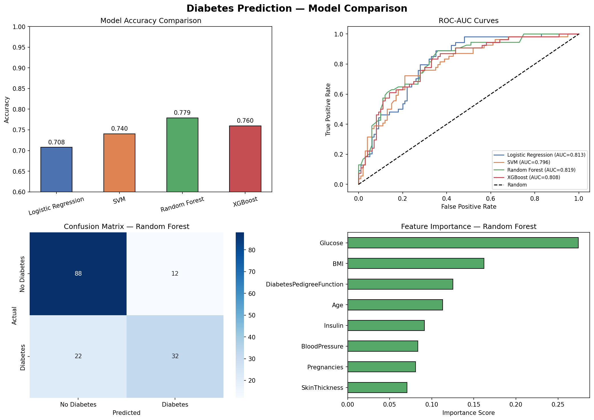

<p align="center">
  
  
  
  
</p>


<p align="center">
  <strong>An end-to-end machine learning application that predicts diabetes risk using clinical health indicators, built with a Streamlit web interface and trained on the Pima Indians Diabetes Dataset.</strong>
</p>

<p align="center">
  <em>Developed as part of the <a href="https://www.codealpha.tech/">CodeAlpha</a> Data Science Internship — Task 4: Disease Prediction from Medical Data</em>
</p>

---

## 📋 Table of Contents

- [Overview](#overview)
- [Demo](#demo)
- [Features](#features)
- [Architecture](#architecture)
- [Dataset](#dataset)
- [Models & Performance](#models--performance)
- [Tech Stack](#tech-stack)
- [Installation](#installation)
- [Usage](#usage)
- [Project Structure](#project-structure)
- [How It Works](#how-it-works)
- [Disclaimer](#disclaimer)
- [Author](#author)

---

## Overview

**DiabetesIQ** is a complete machine learning pipeline that:

1. **Trains and compares** four classification models on clinical health data.
2. **Selects the best-performing model** based on ROC-AUC score.
3. **Deploys the model** behind a polished, dark-themed Streamlit web interface where users can input patient vitals and receive an instant diabetes risk prediction with probability scores.

The project demonstrates the full data science workflow — from exploratory data analysis and preprocessing, through model training and evaluation, to interactive deployment.

---

## Demo

<p align="center">
  
</p>

<p align="center"><em>Model accuracy comparison, ROC-AUC curves, confusion matrix, and feature importance analysis.</em></p>

---

## Features

| Feature | Description |
|---|---|
| 🤖 **Multi-Model Comparison** | Trains and benchmarks Logistic Regression, SVM, Random Forest, and XGBoost side by side |
| 📊 **Comprehensive Evaluation** | Accuracy, ROC-AUC, 5-fold cross-validation, confusion matrices, and classification reports |
| 🌐 **Interactive Web App** | Clean, responsive Streamlit UI with real-time prediction via slider-based inputs |
| 🎨 **Custom Dark Theme** | Professionally styled interface with gradient accents, custom fonts (Syne + DM Sans), and card-based layout |
| 📈 **Visual Analytics** | Auto-generated accuracy bar charts, ROC curves, confusion matrix heatmaps, and feature importance plots |
| 💾 **Model Persistence** | Best model and scaler are serialized with `joblib` for production reuse |
| 📋 **Input Summary Table** | Post-prediction summary comparing user values against normal clinical ranges |

---

## Architecture

```
┌─────────────────────────────────────────────────────────────────┐
│                     diabetes_prediction.py                      │
│  ┌──────────┐   ┌──────────────┐   ┌────────────────────────┐  │
│  │ Load &   │──▶│ Preprocess   │──▶│ Train 4 Models         │  │
│  │ Explore  │   │ (median fill,│   │ (LR, SVM, RF, XGBoost) │  │
│  │ Dataset  │   │  scaling)    │   └───────────┬────────────┘  │
│  └──────────┘   └──────────────┘               │               │
│                                      ┌─────────▼─────────┐     │
│                                      │ Evaluate & Compare │     │
│                                      │ (Acc, AUC, CV)     │     │
│                                      └─────────┬─────────┘     │
│                                      ┌─────────▼─────────┐     │
│                                      │ Save Best Model   │     │
│                                      │ (.pkl files)       │     │
│                                      └───────────────────┘     │
└─────────────────────────────────────────────────────────────────┘
                              │
                              ▼
┌─────────────────────────────────────────────────────────────────┐
│                          app.py                                 │
│  ┌──────────┐   ┌──────────────┐   ┌────────────────────────┐  │
│  │ Load     │──▶│ Accept User  │──▶│ Predict & Display      │  │
│  │ Model /  │   │ Input via    │   │ Risk Assessment with   │  │
│  │ Retrain  │   │ Sliders      │   │ Probability Score      │  │
│  └──────────┘   └──────────────┘   └────────────────────────┘  │
└─────────────────────────────────────────────────────────────────┘
```

---

## Dataset

**Pima Indians Diabetes Dataset** — originally from the National Institute of Diabetes and Digestive and Kidney Diseases (NIDDK).

| Property | Value |
|---|---|
| **Samples** | 768 |
| **Features** | 8 clinical predictors |
| **Target** | Binary (0 = No Diabetes, 1 = Diabetes) |
| **Class Split** | ~65% Negative / ~35% Positive |
| **Source** | [UCI ML Repository](https://raw.githubusercontent.com/jbrownlee/Datasets/master/pima-indians-diabetes.data.csv) |

### Feature Descriptions

| Feature | Unit | Description |
|---|---|---|
| Pregnancies | count | Number of times pregnant |
| Glucose | mg/dL | Plasma glucose concentration (2-hour oral glucose tolerance test) |
| BloodPressure | mm Hg | Diastolic blood pressure |
| SkinThickness | mm | Triceps skinfold thickness |
| Insulin | μU/mL | 2-hour serum insulin |
| BMI | kg/m² | Body mass index |
| DiabetesPedigreeFunction | — | Diabetes heredity score (higher = stronger genetic risk) |
| Age | years | Age of the patient |

---

## Models & Performance

Four classifiers were trained with an 80/20 stratified train-test split:

| Model | Accuracy | ROC-AUC | 5-Fold CV Accuracy |
|---|:---:|:---:|:---:|
| Logistic Regression | 0.708 | 0.813 | — |
| SVM (RBF Kernel) | 0.740 | 0.796 | — |
| **Random Forest** 🏆 | **0.779** | **0.819** | — |
| XGBoost | 0.760 | 0.808 | — |

> **Best Model:** Random Forest achieved the highest ROC-AUC score of **0.819** and was selected as the production model.

### Key Observations

- **Glucose** is the most influential predictor, followed by **BMI** and **DiabetesPedigreeFunction**.
- Tree-based models (Random Forest, XGBoost) outperformed linear models on this dataset.
- The Random Forest confusion matrix shows 88 true negatives and 32 true positives out of 154 test samples.

---

## Tech Stack

| Category | Technologies |
|---|---|
| **Language** | Python 3.8+ |
| **Web Framework** | Streamlit |
| **Machine Learning** | Scikit-learn, XGBoost |
| **Data Processing** | Pandas, NumPy |
| **Visualization** | Matplotlib, Seaborn |
| **Model Serialization** | Joblib |

---

## Installation

### Prerequisites

- Python 3.8 or higher
- pip (Python package manager)

### Steps

1. **Clone the repository**

   ```bash
   git clone https://github.com/ARUNESH-JHA/CodeAlpha_DiabetesPredictor.git
   cd CodeAlpha_DiabetesPredictor
   ```

2. **Create a virtual environment** (recommended)

   ```bash
   python -m venv venv
   source venv/bin/activate        # macOS / Linux
   venv\Scripts\activate           # Windows
   ```

3. **Install dependencies**

   ```bash
   pip install -r requirements.txt
   ```

---

## Usage

### 1. Train Models & Generate Evaluation Report

Run the training pipeline to compare all four models, generate visualizations, and save the best model:

```bash
python diabetes_prediction.py
```

**Outputs:**
- `best_diabetes_model.pkl` — serialized best-performing model
- `scaler.pkl` — fitted StandardScaler for feature normalization
- `diabetes_results.png` — comparison plots (accuracy, ROC, confusion matrix, feature importance)
- Detailed console output with classification reports

### 2. Launch the Web Application

Start the interactive Streamlit prediction interface:

```bash
streamlit run app.py
```

The app will open in your browser at `http://localhost:8501`. Use the sliders to input patient vitals and click **⚡ PREDICT DIABETES RISK** to get an instant risk assessment.

> **Note:** If no pre-trained model files are found, the app automatically trains a fresh Random Forest model on startup using the dataset fetched from the remote URL.

---

## Project Structure

```
CodeAlpha_DiabetesPredictor/
│
├── app.py                     # Streamlit web application (frontend + inference)
├── diabetes_prediction.py     # ML pipeline (training, evaluation, visualization)
├── diabetes_results.png       # Auto-generated model comparison plots
├── requirements.txt           # Python dependencies
└── README.md                  # Project documentation
```

| File | Purpose |
|---|---|
| [`app.py`](app.py) | Streamlit web app with custom dark-themed UI; loads or retrains the model, accepts 8 clinical inputs via sliders, and displays prediction results with probability scores and an input summary table |
| [`diabetes_prediction.py`](diabetes_prediction.py) | Full ML pipeline — loads data, handles missing values (replaces zeros with medians), trains 4 classifiers (LR, SVM, RF, XGBoost), evaluates with accuracy/AUC/CV, generates visualizations, saves the best model |
| [`requirements.txt`](requirements.txt) | Lists all Python package dependencies |
| [`diabetes_results.png`](diabetes_results.png) | 4-panel visualization: accuracy bar chart, ROC-AUC curves, confusion matrix, and feature importance |

---

## How It Works

### Data Preprocessing

1. **Zero-value imputation** — Medical features (`Glucose`, `BloodPressure`, `SkinThickness`, `Insulin`, `BMI`) with value `0` are treated as missing data and replaced with the column median.
2. **Feature scaling** — `StandardScaler` is applied for models sensitive to feature magnitude (Logistic Regression, SVM). Tree-based models use raw features.
3. **Stratified split** — 80/20 train-test split preserves the original class distribution.

### Model Training

- **Logistic Regression** — Linear baseline with L2 regularization (`max_iter=1000`)
- **SVM** — RBF kernel with probability calibration enabled
- **Random Forest** — Ensemble of 100 decision trees (`n_estimators=100`)
- **XGBoost** — Gradient-boosted trees with log-loss objective

### Web Application

- Built with **Streamlit** and styled with injected custom CSS (dark theme, gradient accents, Google Fonts).
- Uses `@st.cache_resource` to cache the model, avoiding reload on every interaction.
- Falls back to training a fresh model if no `.pkl` files are present (zero-config deployment).

---

## Disclaimer

> ⚠️ **This application is for educational and demonstration purposes only.** It is **not** a medical diagnostic tool and should **not** be used as a substitute for professional medical advice, diagnosis, or treatment. Always consult a qualified healthcare provider for medical concerns.

---

## Author

**Arunesh Jha**

- GitHub: [@ARUNESH-JHA](https://github.com/ARUNESH-JHA)

Built as part of the **CodeAlpha Data Science Internship** program.

---


